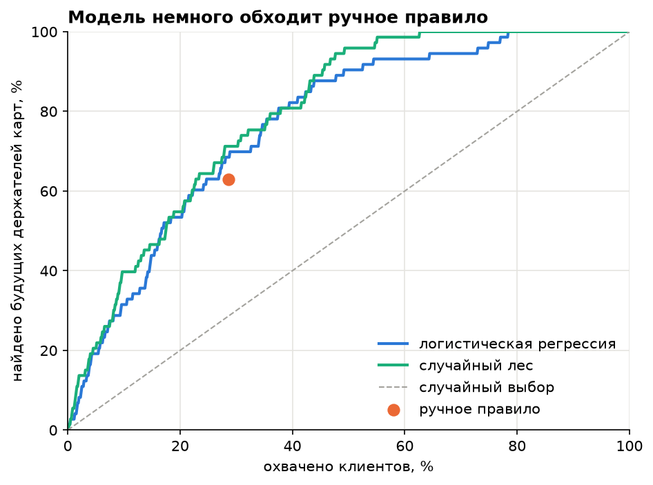
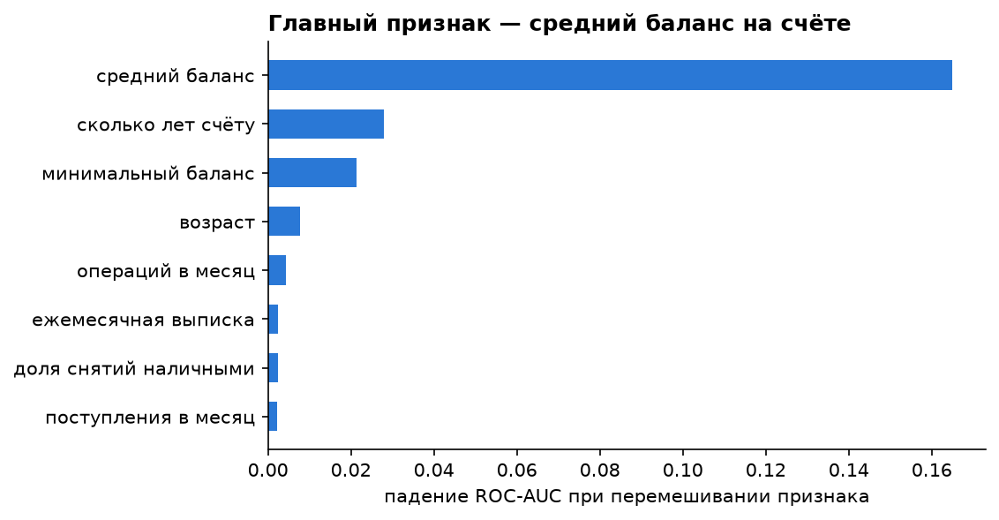

# Кто оформит карту в следующем году

Продолжение проекта [bank-card-analysis](https://github.com/syulzhins/bank-card-analysis). Там я на SQL выяснил, что карта не делает клиента активнее, её берут уже обеспеченные клиенты, и выделил сегмент «кому предлагать карту» ручным правилом. Здесь то же самое делаю моделью на Python: по поведению клиента за 1997 год предсказываю, оформит ли он карту в 1998.

**Стек:** Python, pandas, matplotlib, scikit-learn (логистическая регрессия, случайный лес)

**Ноутбук:** [notebooks/card_model.ipynb](notebooks/card_model.ipynb)

## Постановка

- 3 172 владельца счетов, у которых счёт открыт до 1997 года и карты ещё нет.
- Признаки только за 1997 год: поступления, баланс, число операций, возраст, кредит, район и т.д. Модель не видит будущего, поэтому проверка честная.
- Цель: карта выдана в 1998. Оформили 9%, классы несбалансированные, поэтому смотрю на ROC-AUC и охват, а не на accuracy.

## Результаты

| | ROC-AUC на тесте | находит держателей при охвате 20% |
|---|---|---|
| логистическая регрессия | 0.80 | 53% |
| случайный лес | 0.82 | 55% |
| случайный выбор | 0.50 | 20% |

- Будущие держатели карт уже за год до оформления получают вдвое больше (медиана 21.7 тыс. против 10.6 тыс. в месяц) и моложе. Клиенты 65+ почти не оформляют карту (1.9%).
- Главный признак модели — средний баланс на счёте.
- Ручное правило из SQL-проекта уже работает неплохо: при одинаковом охвате оно находит 46 будущих держателей, а случайный лес — 52. Модель лучше, но не в разы. Её плюс в том, что она ранжирует клиентов, и охват можно выбрать под бюджет.

## Ограничения

- В тесте всего 73 будущих держателя, поэтому разница между моделью и правилом может быть случайной.
- Модель предсказывает, кто оформит карту сам, а не кто оформит её после предложения. Эффект от предложения нужно проверять A/B-тестом.
- Данные 1990-х: переносится подход, а не конкретные цифры.

## Как запустить

1. Скачать датасет Berka ([Kaggle](https://www.kaggle.com/datasets/marceloventura/the-berka-dataset)) и положить CSV в папку `data/`.
2. `pip install -r requirements.txt`
3. Открыть `notebooks/card_model.ipynb` и выполнить все ячейки.
